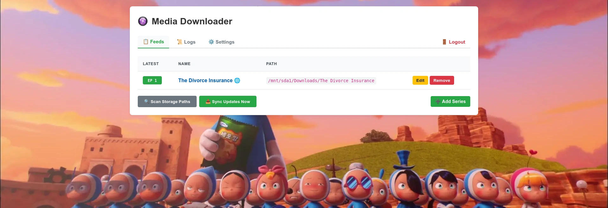
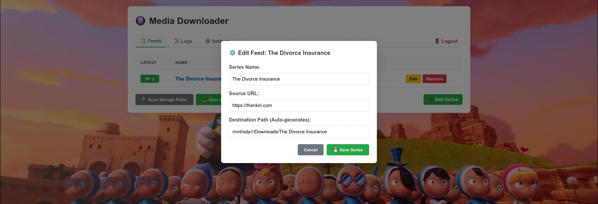
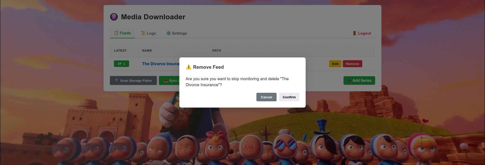
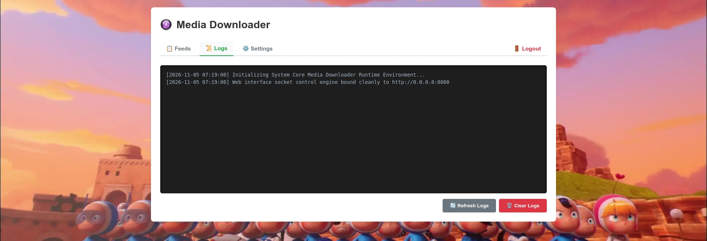
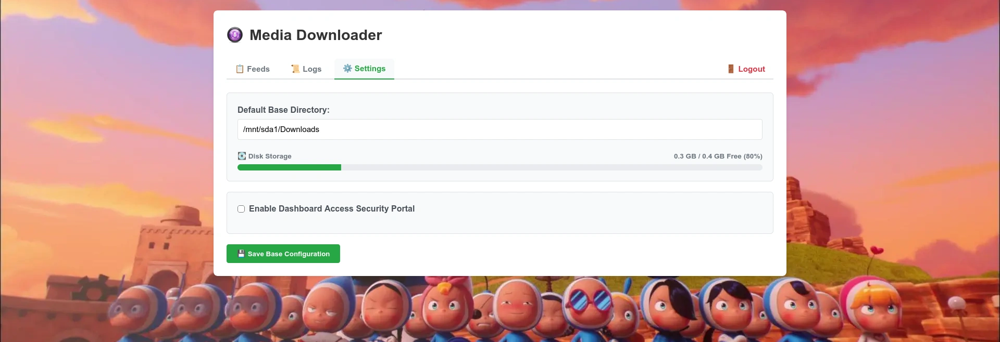

# 🎬 Media Downloader

A lightweight, self-hosted media synchronization engine and web dashboard engineered specifically for resource-constrained systems like **OpenWrt routers** and **Network Attached Storage (NAS) units** (such as UGREEN NAS). It automatically monitors series feeds from targeted Asian drama and movie repositories (such as `thenkiri.com` and `dramakey.com`), solves intermediate file locker configurations natively behind the scenes, and streams media assets straight to attached storage arrays—all with zero operational bloat.

---

## Screenshots








---

## ✨ Features

* **🎛️ Low Memory Footprint:** Built entirely using Python's native standard libraries (`http.server`, `urllib`, and `json`). Does not require heavy third-party framework dependencies like FastAPI, Flask, or BeautifulSoup, preserving host RAM.
* **📱 Progressive Web App (PWA):** Features a fully responsive, mobile-first frontend dashboard layout with fluid tab navigation. Can be installed directly onto your Android, iOS, or desktop home screens as a standalone application.
* **🔓 File Locker & Stream Automation:** Features a built-in form-submission solver tailored to handle intermediate ad-heavy hosting networks (such as `downloadwella.com`) to extract true binary paths dynamically.
* **🔀 Smart Soft Dependencies (FFmpeg & Curl):** Uses an adaptable download pipeline. Direct media links (`.mp4` / `.mkv`) are handled via system `curl` character streams. Fragmented HTTP Live Streaming (`.m3u8`) targets trigger a soft-dependency handoff to local `ffmpeg` workers if installed on the host machine.
* **📊 Real-Time Visual Feedback:** Features an in-memory carriage-return (`\r`) parsing engine that intercepts background downloader strings to drive smooth frontend progress bars and milestone indicators.
* **🔄 State Persistence (UCI Format):** Integrates directly into native embedded system parameters. Target paths, credentials, and downloaded sequences are managed seamlessly via standard configurations stored in `/etc/config/media-downloader`.
* **📁 Directory Validation Synchronizer:** Includes an automated folder scanner that parses storage arrays using context-aware regular expressions. It matches existing files (e.g., `S01E02`, `Ep 4`) and links them back to the configuration records to save network bandwidth.
* **🛡️ Session-Aware Security & Log Pruning:** Equipped with an isolated cookie-based authentication gateway (`SameSite=Strict`, `HttpOnly`) and an active, thread-safe runtime console log terminal featuring a custom UI button to flush RAM memory instantly.
* **💯 Year-Tag Noise Suppression:** Employs an intelligent numerical boundary filter that automatically isolates true episode sequences (`<= 150`) while discarding calendar years (`2025`, `2026`) and common resolution indicators (`720p`, `1080p`).

---

## 🛠️ Package Architecture

The system maintains a clean, lightweight directory footprint when installed:

```text
/
├── etc/
│   ├── config/media-downloader         # Unified UCI configuration storage file
│   ├── crontabs/root                   # System crontab automation timer (using the --cron flag)
│   └── init.d/media-downloader         # procd/systemd service control daemon script
└── usr/
    ├── libexec/media-downloader.py     # Stream-aware core scraping & download server engine
    └── share/media-downloader/         # Web dashboard UI container folder
        ├── index.html                  # Responsive front-end dashboard template layout
        ├── manifest.json               # Progressive Web App configuration file
        ├── sw.js                       # Offline PWA service routing worker
        ├── app-icon.png                # Cohesive branding favicon and app launcher asset
        └── style.css                   # Main application layout style sheet
```

---

## 🚀 Quick Setup & Installation

### 1. Install System Dependencies
Connect to your host machine via SSH and pull down the minimum Python core standard library expansions along with standard system utilities:

```bash
# On OpenWrt:
apk update
apk add python3-light python3-urllib python3-codecs python3-openssl curl

# (Optional for HLS/.m3u8 stream support)
apk add ffmpeg
```

### 2. Standard Configuration Setup (`/etc/config/media-downloader`)
Configure your network bind interface targets, web security settings, and default storage folders. The configuration format follows standard OpenWrt UCI layout blocks:

```text
package media-downloader

config global 'main'
    option bind_address '0.0.0.0'
    option port '8080'
    option base_dir '/mnt/sda1/Downloads'
    option auth_enabled '1'
    option auth_username 'admin'
    option auth_password 'admin'

config series 'thedivorceinsurance'
    option name 'The Divorce Insurance'
    option url 'https://thenkiri.com'
    option path '/mnt/sda1/Downloads/The Divorce Insurance'
    option downloaded_episodes '1'
    option last_update '1711910540'
```

### 3. Enable System Automation Services
To guarantee the application daemon launches automatically on system boots, run:

```bash
# Enable and launch the web engine daemon service
/etc/init.d/media-downloader enable
/etc/init.d/media-downloader start
```

To run headlight scraping cycles seamlessly in the background without launching the persistent HTTP server socket, configure a cron entry to pass the explicit execution flag:

```text
0 0 * * * /usr/libexec/media-downloader.py --cron
```

---

## 📱 Mobile PWA Installation Guide

Because mobile browsers restrict progressive web app installation features to secure network states, you must either set up a HTTPS proxy to connect to the app, or you must access the local dashboard through an address context the browser inherently trusts:

1. Connect to your router/NAS via SSH using local port forwarding (e.g., tunnel local port `8080` to `127.0.0.1:8080`).
2. Open Chrome or Safari on your phone and head directly to **`http://localhost:8080`**.
3. Tap **Add to Home Screen** or **Install App** to deploy the native app wrapper to your device launcher.

---

## 📄 License
This application is distributed as free, open-source software under the Apache License 2.0. Feel free to modify and adapt it for your personal home labs!
