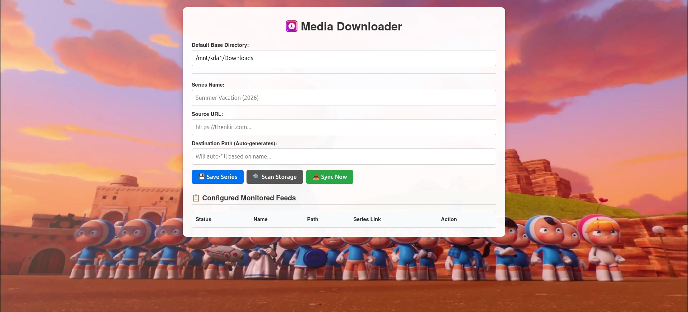

# 🎬 Media Downloader

A lightweight, self-hosted media synchronization engine and web dashboard engineered specifically for **OpenWrt 25.12+**. It automatically monitors series feeds from targeted Asian drama and movie repositories, solves intermediate file locker configurations natively behind the scenes, and downstreams clean media files straight to your router's attached storage arrays—all with zero operational bloat.




---

## ✨ Features

* **🎛️ Low Memory Footprint:** Built entirely using Python's native standard libraries (`http.server` and `urllib`). Does not require heavy third-party framework dependencies, making it perfectly suited for resource-constrained embedded storage environments.
* **📱 Progressive Web App (PWA):** Features a fully responsive, mobile-first frontend dashboard layout. Can be installed directly onto your Android, iOS, or desktop home screens as a standalone application.
* **🔓 File Locker Automation:** Features a built-in form-submission solver tailored to handle intermediate ad-heavy hosting networks (such as `downloadwella.com`) to extract true, unthrottled `.mkv` and `.mp4` stream targets automatically.
* **🔄 State Persistence (UCI Format):** Integrates directly into OpenWrt's native configuration layer. Settings, destination paths, and historical download sequences are managed seamlessly via standard configurations stored in `/etc/config/media-downloader`.
* **📁 Directory Synchronizer:** Includes a manual folder scanner that matches local naming conventions against your data files, automatically logging previously existing media files so they are never redownloaded.
* **⏳ Status Smart Badges:** Tracks tracking health dynamically. Feeds transition intelligently between **Monitoring**, **Active**, and **Complete** based on your download history and data aging (e.g., automatically flags as *Complete* if no new episodes are detected for 3 weeks).

---

## 🛠️ OpenWrt Package Architecture

The system splits into a clean, lightweight directory footprint when installed:

```text
/
├── etc/
│   ├── config/media-downloader         # Unified UCI configuration storage file
│   ├── crontabs/media-downloader       # Automation timer configuration (Once-a-day cron)
│   └── init.d/media-downloader         # procd system service control daemon script
└── usr/
    ├── libexec/media-downloader.py    # Multi-threaded core scraping & download server engine
    └── share/media-downloader/         # Web dashboard UI container folder
        ├── index.html                  # Responsive front-end dashboard template layout
        ├── manifest.json               # Progressive Web App configuration file
        ├── sw.js                       # Lightweight offline PWA service routing worker
        ├── app-icon.png                # Cohesive branding favicon and app launcher asset
        └── wallpaper.webp              # Dashboard stretched background graphic
```

---

## 🚀 Quick Setup & Installation

### 1. Install System Dependencies
Connect to your router via SSH and pull down the minimum Python core standard library expansions:

```bash
apk update
apk add python3-light python3-urllib python3-codecs python3-openssl
```

### 2. Standard Configuration Setup (`/etc/config/media-downloader`)
Configure your network bind interface targets and default media storage folders. The server will dynamically create folder paths matching your configured series:

```text
package media-downloader

config global 'main'
    option bind_address '0.0.0.0'
    option port '8080'
    option base_dir '/mnt/sda1/Downloads'

config series 'thedivorceinsurance'
    option name 'The Divorce Insurance'
    option url 'https://thenkiri.com'
    option path '/mnt/sda1/Downloads/The Divorce Insurance'
    option downloaded_episodes '1'
    option last_update '1711910540'
```

<h3>3. Enable System Automation Services</h3>
To guarantee the background app launches automatically on router boots and checks for new episodes once a day at midnight, run:

```bash
# Enable and launch the web engine daemon
/etc/init.d/media-downloader enable
/etc/init.d/media-downloader start

# Activate automated cron cycles
/etc/init.d/cron restart
```

---

## 📱 Mobile PWA Installation Guide

Because mobile browsers restrict progressive web app features to secure network states, you must access the local dashboard through an address context the browser inherently trusts:

1. Connect to your router via SSH using local port forwarding (e.g., tunnel local port `8080` to `127.0.0.1:8080`).
2. Open Chrome or Safari on your phone and head directly to **`http://localhost:8080`**.
3. Tap **Add to Home Screen** or **Install App** to deploy the native app wrapper to your device launcher.

---

## 📄 License
This application is distributed as free, open-source software under the MIT License. Feel free to modify and adapt it for your personal home labs!
